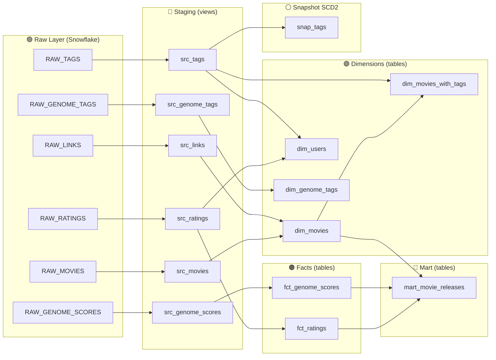
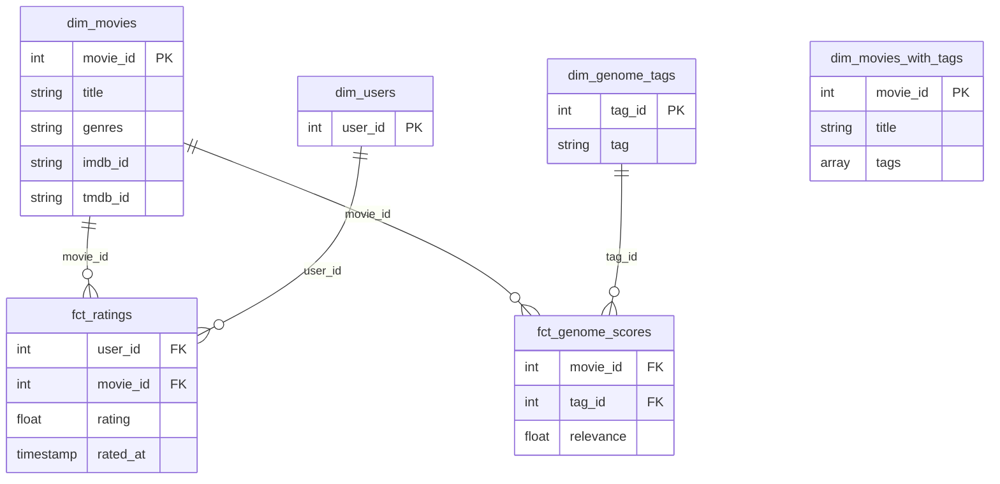
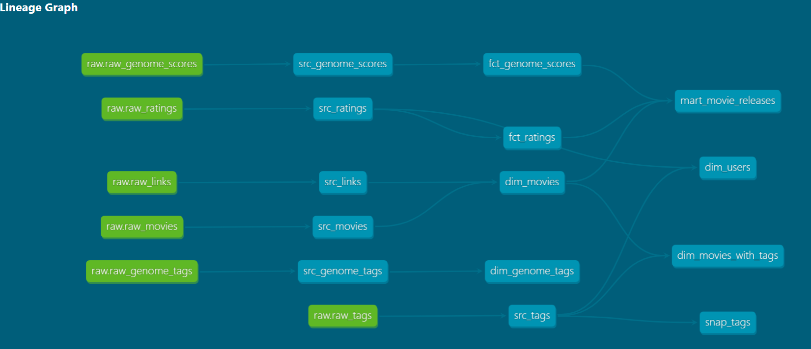

# Netflix Movie Recommendation — dbt + Snowflake ELT Pipeline


> ⚠️ **Note sur le compte Snowflake** : ce projet a été développé sur un compte Snowflake Trial (gratuit, 30 jours). Le trial expire début 24/09/2026 — au-delà de cette date, les captures d'écran ci-dessous restent la preuve du bon fonctionnement du pipeline, mais l'environnement live ne sera plus accessible sans recréation d'un nouveau compte.

## ⚠️ Clarification importante

Ce projet **n'est pas** basé sur de vraies données Netflix et **n'implémente pas** de moteur de recommandation par machine learning. Il utilise le dataset public [MovieLens](https://grouplens.org/datasets/movielens/) (GroupLens Research), couramment utilisé comme base académique pour les systèmes de recommandation. Le nom "Netflix Movie Recommendation" désigne le thème du projet, pas une source de données réelle.

**Ce que ce projet démontre réellement** : la construction d'un pipeline **ELT (Extract-Load-Transform)** complet avec dbt et Snowflake — ingestion de données brutes, modélisation dimensionnelle, tests de qualité, historisation SCD2 et documentation générée automatiquement. C'est un projet de **data / analytics engineering**.

---

## 🎯 Objectif du projet

Transformer des fichiers CSV bruts et désordonnés (ratings, tags, métadonnées de films) en un modèle de données propre, testé et documenté, prêt à être consommé par un outil de BI. Le tout en suivant une **architecture médaillon** (raw → staging → dimensional → mart), standard dans l'industrie.

## 🏗️ Architecture



## ⭐ Modèle dimensionnel (star schema)



## 🔗 Lineage graph (dbt docs)

*(capture d'écran de `dbt docs generate` → `dbt docs serve`)*



---

## 🧰 Stack technique

| Composant | Rôle |
|---|---|
| **Snowflake** | Data warehouse cloud, stockage + calcul des transformations |
| **dbt-core / dbt-snowflake** | Orchestration des transformations SQL, tests, docs, snapshots |
| **SnowSQL CLI** | Chargement du fichier volumineux `genome-scores.csv` (~435MB) via `PUT` + `COPY INTO` |
| **Python (venv)** | Isolation de l'environnement dbt |

## 📊 Dataset

- **ml-latest-small** (MovieLens) pour `movies`, `ratings`, `tags`, `links`
- **ml-25m** (MovieLens) pour `genome-scores` (~15.5M lignes) et `genome-tags`, car ces fichiers n'existent pas dans la version "small"

⚠️ Point technique à noter : les `movie_id` ne sont pas garantis identiques entre les deux versions du dataset (ml-25m contient plus de films) — d'où l'usage systématique de `LEFT JOIN` plutôt que `INNER JOIN` dans les modèles dimension, pour ne pas perdre silencieusement des lignes.

---

## 📁 Structure du projet

```
netflix_recommendation/
├── dbt_project.yml
├── models/
│   ├── staging/
│   │   ├── sources.yml
│   │   ├── src_movies.sql
│   │   ├── src_ratings.sql
│   │   ├── src_tags.sql
│   │   ├── src_links.sql
│   │   ├── src_genome_scores.sql
│   │   └── src_genome_tags.sql
│   ├── dim/
│   │   ├── dim.yml                    # tests unique/not_null + macro custom
│   │   ├── dim_movies.sql
│   │   ├── dim_users.sql
│   │   ├── dim_genome_tags.sql
│   │   └── dim_movies_with_tags.sql
│   ├── fct/
│   │   ├── fct.yml                    # tests relationships (FK)
│   │   ├── fct_ratings.sql
│   │   └── fct_genome_scores.sql
│   └── mart/
│       └── mart_movie_releases.sql
├── macros/
│   └── test_no_nulls_in_columns.sql   # test générique custom
├── snapshots/
│   └── snap_tags.sql                  # SCD2 sur les tags
└── figures/
    └── lineage-graph.png
```

---

## 🧱 Description des modèles

### Staging (views)
Renommage de colonnes (`movieId` → `movie_id`) et cast, **sans jointure** — chaque modèle correspond 1-to-1 à une source raw, pour garder la traçabilité.

- `src_movies`, `src_ratings`, `src_tags`, `src_links`, `src_genome_scores`, `src_genome_tags`

### Dimensions (tables)
- **dim_movies** : films enrichis avec les IDs IMDb/TMDb (`LEFT JOIN` src_movies + src_links)
- **dim_users** : liste unique des `user_id` extraite de ratings + tags (`UNION`)
- **dim_genome_tags** : référentiel des ~1000 tags "génome"
- **dim_movies_with_tags** : films + tags libres agrégés en array (`ARRAY_AGG`), grain conservé à 1 ligne/film

### Facts (tables)
- **fct_ratings** — grain : *(user, movie, moment de notation)*
- **fct_genome_scores** — grain : *(movie, tag)*, score de pertinence ML

### Mart (table)
- **mart_movie_releases** — 1 ligne par film, avec année de sortie extraite du titre (`REGEXP_SUBSTR`), nombre de ratings, note moyenne, nombre de tags pertinents (`relevance > 0.5`)

---

## ✅ Tests de qualité des données

| Type | Où | Description |
|---|---|---|
| `unique` + `not_null` | `dim_movies.movie_id`, `dim_users.user_id` | Intégrité des clés primaires |
| `relationships` | `fct_ratings.movie_id/user_id` | Intégrité référentielle vers les dimensions (FK) |
| `not_null` | `fct_ratings.rating` | Pas de note manquante |
| **Test générique custom** `no_nulls_in_columns` | `dim_movies_with_tags` | Macro Jinja réutilisable : vérifie qu'aucune colonne d'une liste donnée n'est NULL, en un seul test |

```bash
dbt test
```

## 🕒 Snapshot SCD2 — historisation des tags

`snap_tags` historise les changements sur `src_tags` avec la stratégie `timestamp` (comparaison sur `tagged_at`). Si un tag change de valeur ou disparaît, dbt conserve l'ancienne version avec `dbt_valid_to` renseigné, et la nouvelle version comme ligne active.

```bash
dbt snapshot
```

---

## ⚙️ Installation

```bash
# 1. Environnement virtuel
python -m venv venv
venv\Scripts\activate          # Windows

# 2. Installation dbt + adapter Snowflake
pip install dbt-snowflake

# 3. Init projet (déjà fait dans ce repo, à titre indicatif)
dbt init netflix_recommendation
```

Configurer `~/.dbt/profiles.yml` (fichier **non versionné**, contient les credentials) :

```yaml
netflix_recommendation:
  outputs:
    dev:
      type: snowflake
      account: <ton_account>
      user: <ton_user>
      password: <ton_password>
      role: ACCOUNTADMIN
      database: NETFLIX_DB
      warehouse: COMPUTE_WH
      schema: RAW
      threads: 4
  target: dev
```

## 🚀 Commandes principales

```bash
dbt debug                        # Vérifier la connexion
dbt run --select staging         # Modèles staging
dbt run --select dim             # Dimensions
dbt run --select fct             # Facts
dbt run --select mart            # Mart
dbt test                         # Tous les tests
dbt snapshot                     # Snapshot SCD2
dbt docs generate && dbt docs serve   # Documentation + lineage graph
```

---

## 💡 Points techniques à retenir (pour discussion en entretien)

- **Pourquoi staging = views et dim/fct/mart = tables** : les views ne stockent rien (coût nul, toujours fraîches) et suffisent pour un simple renommage. Dim/fct/mart impliquent jointures et agrégations coûteuses sur des millions de lignes → matérialisées en table pour éviter de tout recalculer à chaque requête.
- **Chargement du gros fichier `genome-scores.csv` (435MB, 15.5M lignes)** : l'upload via l'interface web Snowsight a une limite de taille. Utilisation de SnowSQL avec `PUT` (upload vers un stage interne, compression automatique en `.gz`) puis `COPY INTO` (chargement stage → table).
- **`source()` vs `ref()`** : `source()` référence une table raw déclarée dans `sources.yml` (lineage + découplage) ; `ref()` référence un autre modèle dbt (gère automatiquement l'ordre d'exécution du DAG).
- **Grain d'un modèle de fait** : ce qui définit une ligne unique. Mal définir le grain (ex: joindre sans agréger) provoque une duplication de lignes silencieuse — piège classique en modeling.
- **`LEFT JOIN` systématique en dimension** : pour ne jamais perdre silencieusement des entités (film sans lien IMDb, user sans tag, etc.) à cause d'une jointure trop stricte.

---

## 📌 Statut du projet

- [x] Setup Python + dbt-snowflake + Snowflake
- [x] Raw layer (6 tables chargées)
- [x] Staging (6 modèles)
- [x] Dimensions (4 modèles, star schema)
- [x] Facts (2 modèles)
- [x] Mart (1 modèle d'agrégation business)
- [x] Tests built-in + test générique custom + macro
- [x] Snapshot SCD2
- [x] Documentation + lineage graph

*Projet réalisé dans un but d'apprentissage approfondi de dbt et de la modélisation dimensionnelle sur Snowflake.*